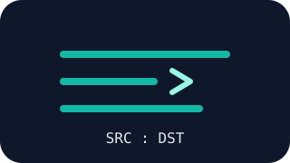

<div align="center">


[](LICENSE)
[](https://github.com/CyberLoop-dev/git-refspec-explainer)
[](https://github.com/CyberLoop-dev/git-refspec-explainer/stargazers)
[](https://github.com/CyberLoop-dev/git-refspec-explainer/commits/main)

</div>

## 🧭 Overview
A read-only Python CLI that explains a useful subset of Git refspec syntax by mapping sample source refs to destination refs. It never invokes Git or changes repository data.

## ✨ Features
- 🌿 Parses force, wildcard, deletion, and negative refspec forms.
- 🧭 Shows the source-to-destination mapping for supplied refs.
- 🚫 Applies negative patterns as exclusions.
- 🧪 Includes tests for parsing, matching, and invalid patterns.

## 🖥️ Demo
No hosted demo is published. Try the CLI with the example below.

## 🚀 Quick Start
```bash
python main.py --refspec '+refs/heads/*:refs/remotes/origin/*' --refs refs/heads/main,refs/heads/dev
```
Run tests with `python -m unittest discover -s tests -v`.

## 🧰 Tech Stack
Python 3.10+ standard library only. No third-party dependencies.

## 🗂️ Folder Structure
```text
git-refspec-explainer/
├── main.py
├── tests/
├── assets/
├── .github/workflows/
└── pyproject.toml
```

## 🛣️ Roadmap
- [x] Explain wildcard, force, deletion, and negative patterns.
- [x] Read-only mapping simulation.
- [ ] Add additional fetch/push examples and diagnostics.

## 🤝 Contributing
Pull requests are welcome. Keep the simulator read-only and add tests for new syntax.

## 📄 License
MIT — see [LICENSE](LICENSE).

<div align="center">

</div>
